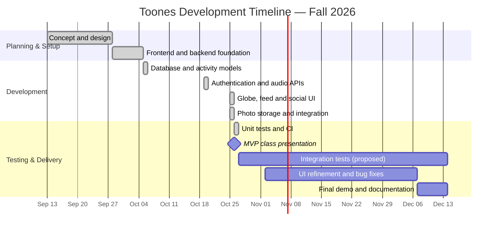

# Toones — Project Timeline & Task Tracker

**Course:** CS450 Capstone · Fall 2026  
**Updated:** October 26, 2026  
**Application:** https://toones.vercel.app/auth  
**GitHub:** https://github.com/ToonesApp

## Project Overview

Toones is a location-based social audio application where users can discover and share short recordings associated with places. The MVP brings together a map/globe interface, user authentication, an audio feed, uploads, and early social features.

## Team & Responsibilities

| Member | Primary focus | Contributions |
|---|---|---|
| **Pranish Uprety** | Backend development; project tracking | Express API, authentication, Google sign-in, audio upload/feed, GridFS integration, Render configuration, timeline documentation |
| **Anuj Khadka** | Frontend and social experience; presentation | Initial frontend, layouts, landing/auth views, profile and friends UI, presentation preparation |
| **Binayak** | Maps, feed and visual experience; presentation | Design system, globe interface, sound drops, feed and photo integration, presentation preparation |
| **Rahul Mandal** | Database and quality assurance | Sound and activity models, frontend authentication integration, unit tests, GitHub Actions CI, test documentation |

## Milestone Timeline

| Date | Milestone | Contributors | Result |
|---|---|---|---|
| **Sep 13** | Product concept established | Team | Location-based soundscape/social audio app selected |
| **Sep 14–28** | Design and repository setup | Anuj, Binayak, Pranish | GitHub organization/design system; frontend and backend repositories initialized |
| **Sep 28** | Backend authentication foundation | Pranish | Express backend setup and authentication foundation committed |
| **Sep 28** | Architecture updated | Pranish, frontend team | Initial combined codebase reorganized into separate frontend and backend repositories |
| **Oct 5** | Database models | Rahul | Sound schema, user XP, listens and follows models added |
| **Oct 19** | Backend and authentication integration | Pranish, Rahul | Google sign-in, audio feed and GridFS storage; frontend login/sign-up connected to backend |
| **Oct 19** | Deployment configuration | Pranish | Render build and service configuration added |
| **Oct 25–26** | Frontend MVP refinement | Anuj, Binayak | Globe, sound drops, feed, profile, friends and photo views updated |
| **Oct 26** | Media storage | Binayak | Photo storage added to MongoDB GridFS |
| **Oct 26** | Automated testing | Rahul | Six unit tests, GitHub Actions CI and testing documentation added |
| **Oct 26** | MVP presentation | Team | Presentation and demo milestone |

## Task Status

**Status key:** ✅ Completed · 🔄 In progress · 📅 Planned · 🔀 Changed · ⛔ Cancelled · 🗑️ Removed

| ID | Task | Owner(s) | Date / target | Status | Evidence or notes |
|---|---|---|---|---|---|
| 01 | Project concept and initial scope | Team | Sep 13 | ✅ Completed | Soundscape app selected |
| 02 | Frontend initialization and layouts | Anuj, Binayak | Sep 28 | ✅ Completed | [Frontend commits](https://github.com/ToonesApp/toones-frontend/commits/main/) |
| 03 | Backend foundation and authentication | Pranish | Sep 28 | ✅ Completed | [Authentication commit](https://github.com/ToonesApp/toones-backend/commit/883bacd4a) |
| 04 | Sound and user-activity database schemas | Rahul | Oct 5 | ✅ Completed | [Schema PR](https://github.com/ToonesApp/toones-backend/pull/1), [activity PR](https://github.com/ToonesApp/toones-backend/pull/2) |
| 05 | Google sign-in endpoint | Pranish | Oct 19 | ✅ Completed | [Backend commit](https://github.com/ToonesApp/toones-backend/commit/203df7901) |
| 06 | Sound feed API and audio storage | Pranish | Oct 19 | ✅ Completed | [GridFS/API commit](https://github.com/ToonesApp/toones-backend/commit/2ab171dbe) |
| 07 | Frontend login and sign-up API integration | Rahul | Oct 19 | ✅ Completed | [Frontend PR](https://github.com/ToonesApp/toones-frontend/pull/2) |
| 08 | Globe, feed and photo integration | Binayak | Oct 25–26 | ✅ Completed | [Globe commit](https://github.com/ToonesApp/toones-frontend/commit/cbff744c4), [photo UI commit](https://github.com/ToonesApp/toones-frontend/commit/cc41113af) |
| 09 | Profile and friends interface | Anuj | Oct 25–26 | ✅ Completed | [Profile commit](https://github.com/ToonesApp/toones-frontend/commit/cf1d84355), [friends PR](https://github.com/ToonesApp/toones-frontend/pull/3) |
| 10 | Backend photo storage | Binayak | Oct 26 | ✅ Completed | [GridFS photos commit](https://github.com/ToonesApp/toones-backend/commit/a7e0992cc) |
| 11 | Unit tests, CI pipeline and test plan | Rahul | Oct 26 | ✅ Completed | [Testing PR](https://github.com/ToonesApp/toones-backend/pull/7), [test plan](https://github.com/ToonesApp/toones-backend/blob/main/docs/TESTING.md) |
| 12 | Navigation icon fix | Binayak | Open since Oct 5 | 📅 Planned | [Open issue](https://github.com/ToonesApp/toones-frontend/issues/1) |
| 13 | MVP slides and demonstration | Anuj, Binayak | Oct 26 | 🔄 In progress | Team assignment |
| 14 | Project tracking documentation | Pranish | Oct 26 | 🔄 In progress | This tracker |
| 15 | Split original combined repository | Team | Sep 28 | 🔀 Changed | [Backend restructuring](https://github.com/ToonesApp/toones-backend/commit/45933cafe) |
| 16 | Remove demo seed credentials | Rahul | Oct 26 | 🗑️ Removed | [Removal PR](https://github.com/ToonesApp/toones-backend/pull/6) |
| 17 | Expand API and integration tests | Rahul | By Dec 14 | 📅 Planned | [Testing Phase 2](https://github.com/ToonesApp/toones-backend/blob/main/docs/TESTING.md) |
| 18 | End-to-end MVP verification and bug fixes | Team | Nov–Dec (proposed) | 📅 Planned | Login, browse, upload, playback and cross-device checks |
| 19 | Final product polish and course deliverables | Team | Dec (proposed) | 📅 Planned | Final demo and documentation |

*Completed means the identified code or documentation was committed or merged; it does not guarantee full production testing.*

## Changes, Removals & Cancellations

| Date | Original approach or task | Decision | Status |
|---|---|---|---|
| Sep 28 | Frontend and backend in an initial combined repository structure | Reorganized into separate frontend and backend repositories | 🔀 Changed |
| Oct 26 | Demo seed accounts and password in the codebase | Demo credentials removed | 🗑️ Removed |
| — | Cancelled tasks | No team-confirmed cancellations recorded yet | — |

## Development Gantt Chart

## Remaining Semester: Proposed Roadmap

| Period | Focus | Expected output |
|---|---|---|
| **Late October** | MVP review and defect triage | Verified feature list and prioritized issues |
| **November** | UI refinement, social features and reliability | Improved user flows and resolved bugs |
| **November–December** | Expanded API/integration testing | Better automated coverage and CI results |
| **December** | Final polish, documentation and product demo | Final capstone deliverables |

## Project Links

- [Live application](https://toones.vercel.app/auth)
- [GitHub organization](https://github.com/ToonesApp)
- [Frontend repository](https://github.com/ToonesApp/toones-frontend)
- [Backend repository](https://github.com/ToonesApp/toones-backend)
- [Backend test plan](https://github.com/ToonesApp/toones-backend/blob/main/docs/TESTING.md)
